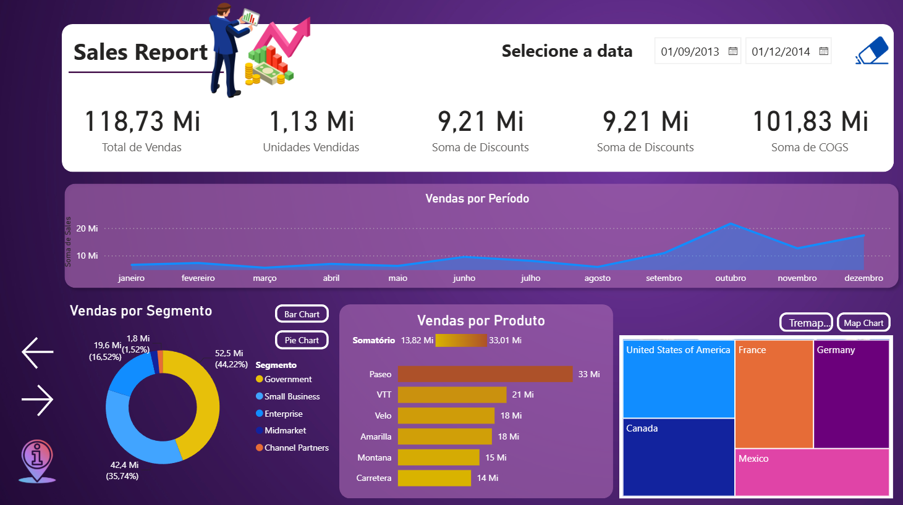
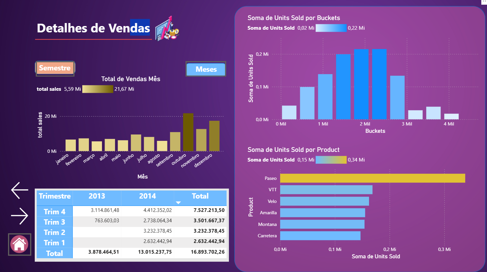
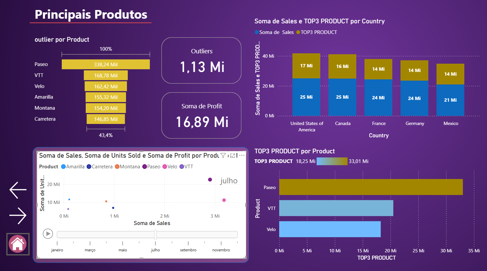
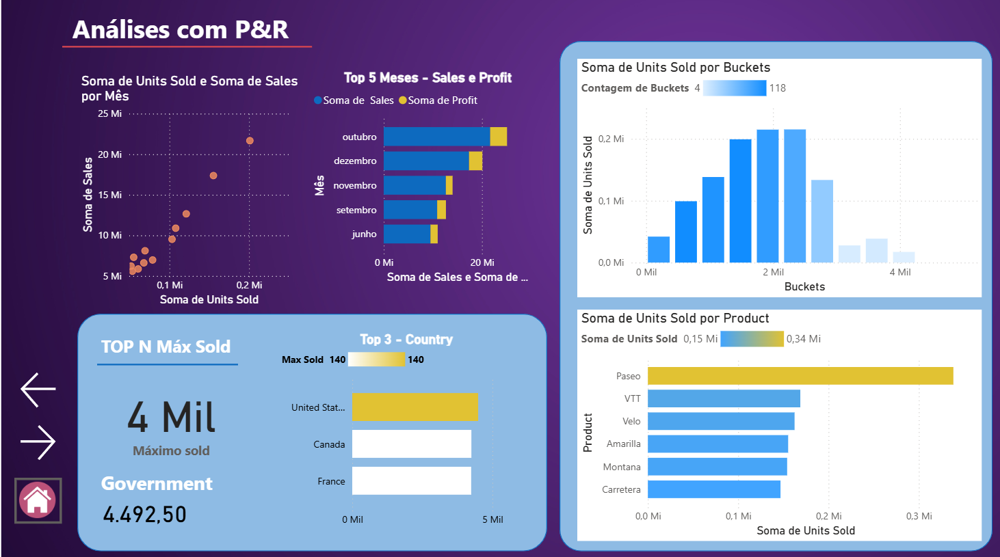
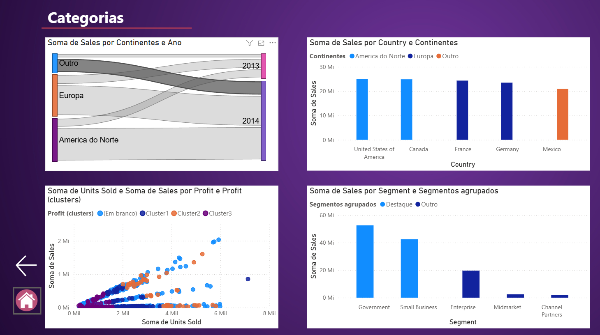

# Desafio Final — Relatório de Vendas em Power BI

Relatório interativo de vendas em **Power BI**, desenvolvido como projeto final de um curso/bootcamp da **DIO (Digital Innovation One)**. O repositório contém o arquivo do relatório: [`sales_report_desafio_projeto_final.pbix`](sales_report_desafio_projeto_final.pbix).

## O que o relatório contém

O relatório tem **6 páginas**:

| Página | Conteúdo observado no arquivo |
| --- | --- |
| **Home page** | Página inicial com botão de navegação |
| **Principal** | Cartões de indicadores, filtro (slicer), gráficos de barras, rosca, área, treemap e mapa. Títulos como "Vendas x Segmento", "Vendas por Segmento", "Vendas por Período" e "Vendas por Produto" |
| **Detalhes** | Gráficos de colunas e de barras, tabela dinâmica (matriz). Títulos como "Vendas por Semestre" e "Total de Vendas Mês" |
| **TOPN e Outliers** | Gráficos de colunas e de barras, dispersão, funil e cartões |
| **Data Analytics** | Cartões, gráficos de barras e colunas, dispersão. Títulos como "Top 3 - Country" e "Top 5 Meses - Sales e Profit" |
| **Categorias e Clusters** | Gráficos de colunas, dispersão e diagrama Sankey |

O relatório usa navegação por botões entre as páginas, imagens de fundo personalizadas e visuais personalizados incorporados ao arquivo, entre eles **Sankey**, **Bullet Chart**, **Chiclet Slicer** e **Power KPI**.

## Perguntas que o relatório responde

As páginas analisam as **vendas por segmento, produto, país e período**, com visões de detalhe, TOP N e outliers, e agrupamentos (clusters).

## Dados

Os dados são um conjunto de exemplo da Microsoft/Power BI (informação do autor).

## Modelo de dados

O modelo tem uma tabela principal, `financials`, com campos como `Date`, `Country`, `Segment`, `Product`, `Units Sold`, `Sales`, `Gross Sales`, `Discounts`, `Discount Band`, `COGS`, `Profit`, `Manufacturing Price` e `Sale Price`, além de campos de calendário (ano, mês, semestre).

Os visuais também usam campos criados no próprio modelo, como `Continentes`, `Segmentos agrupados`, `Buckets`, `outlier`, `TOP3 PRODUCT` e `Profit (clusters)`.

## Como abrir

1. Instale o [Power BI Desktop](https://www.microsoft.com/power-platform/products/power-bi/desktop) (Windows).
2. Baixe o arquivo `.pbix` e abra-o. O modelo de dados está incorporado ao arquivo.

## Competências demonstradas

Modelagem de dados, medidas e colunas calculadas, visualização de dados, design de navegação entre páginas, análise de outliers, TOP N e agrupamentos.

## Capturas de tela

**Página inicial**

**Principal** — indicadores, vendas por período, segmento, produto e país

**Detalhes de Vendas** — vendas por mês/semestre, matriz por trimestre e ano, unidades por faixa e produto

**Principais Produtos** — outliers, TOP 3 de produtos por país e dispersão animada por mês

**Análises com P&R** — vendas e unidades por mês, TOP 5 meses, TOP N por país e faixas de unidades

**Categorias** — vendas por continente e ano (Sankey), por país, por segmento agrupado e clusters de lucro

> Nas capturas, os títulos das páginas são "Principal", "Detalhes de Vendas", "Principais Produtos", "Análises com P&R" e "Categorias"; os nomes internos das abas no arquivo `.pbix` são os da tabela acima.

## Autor

Willian Gomes — https://github.com/wiUl
